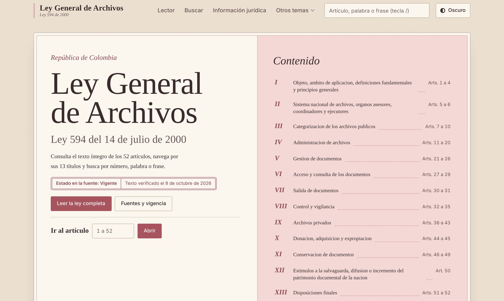
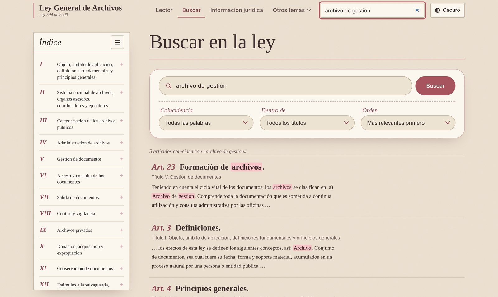
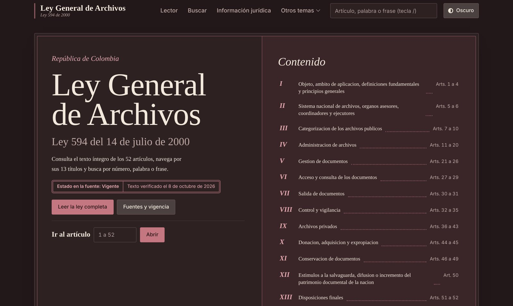
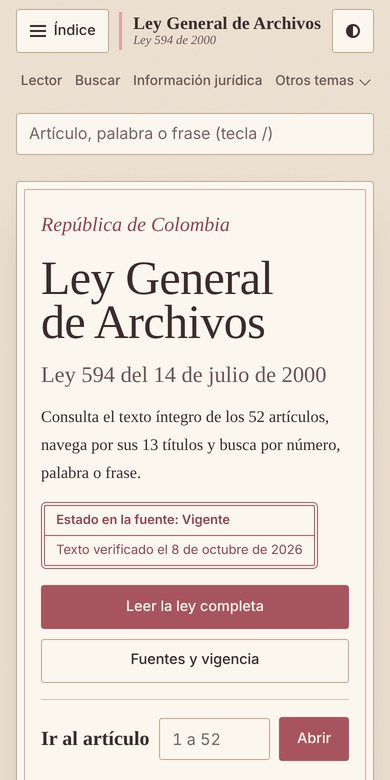

<h1 align="center">Ley General de Archivos</h1>
<p align="center"><b>Ley 594 de 2000 · República de Colombia</b></p>

<p align="center">
  Lector web del texto íntegro de la ley: 52 artículos, 13 títulos,<br>
  búsqueda avanzada y guías de gestión documental.
</p>

<p align="center">
  <a href="https://angelsamuel0326.github.io/ley-594-2000-web/"><b>📖 Ver el sitio en vivo</b></a>
</p>

<p align="center">
  
  
  
  
  
</p>

<p align="center">
  
</p>

---

## Contenido

- [Descripción](#descripción)
- [Vista previa](#vista-previa)
- [Funcionalidades](#funcionalidades)
- [Tecnologías](#tecnologías)
- [Estructura del proyecto](#estructura-del-proyecto)
- [Cómo ejecutarlo](#cómo-ejecutarlo)
- [Fuente del texto legal](#fuente-del-texto-legal)
- [Equipo](#equipo)

## Descripción

Sitio web para leer y consultar la **Ley 594 de 2000**, por la cual se dicta la Ley General de Archivos de Colombia. Está pensado como un libro jurídico digital: tipografía editorial, índice navegable y lectura cómoda en computador y celular.

El texto legal se conserva tal como lo publica la fuente oficial, con su redacción y ortografía. Las notas explicativas viven aparte y **nunca se mezclan** con el texto de la ley. La portada indica el estado de la norma en la fuente («Vigente») y la fecha en que se verificó el texto.

## Vista previa

| Búsqueda con resultados resaltados | Modo oscuro |
|---|---|
|  |  |

<p align="center">
  <br>
  <sub>Versión móvil</sub>
</p>

## Funcionalidades

| | |
|---|---|
| **Lector por títulos** | Los 52 artículos organizados en 13 títulos, con índice lateral desplegable («Abrir todo» y «Cerrar todo»). |
| **Ir al artículo** | Salto directo por número, del 1 al 52. |
| **Búsqueda avanzada** | Por número, palabra o frase, con filtros de coincidencia (todas las palabras), alcance (por título) y orden por relevancia. Resalta los términos encontrados y muestra un fragmento de cada artículo. |
| **Información jurídica** | Fuentes y vigencia de la norma. |
| **Otros temas** | Guías de gestión documental: memorando, documento, radicador de envío de documentos, y paginar y foliar. |
| **Modo claro y oscuro** | Respeta la preferencia del sistema y recuerda tu elección. |
| **Accesibilidad** | Enlace «Saltar al contenido», atajo de teclado `/` para buscar y controles con estados para lectores de pantalla. |
| **Responsivo** | Diseño adaptado a celular, tableta y computador, con estilos de impresión. |

## Tecnologías

| Capa | Herramientas |
|---|---|
| Estructura y estilos | HTML5 y CSS3 (variables de tema, modo oscuro, impresión) |
| Lógica | JavaScript puro, sin frameworks ni dependencias |
| Tipografía | Cormorant Garamond, Libre Caslon Text e Instrument Sans (Google Fonts) |
| Publicación | GitHub Pages |

## Estructura del proyecto

```
ley-594-2000-web/
├── index.html          # página principal
├── css/
│   └── app.css         # estilos, modo oscuro e impresión
├── js/
│   ├── data.js         # texto de la ley, títulos y notas editoriales
│   ├── app.js          # lector, índice, navegación y tema
│   ├── search.js       # motor de búsqueda
│   ├── components.js   # componentes de la interfaz
│   └── otros.js        # guías de «Otros temas»
└── docs/
    └── img/            # capturas para este README
```

Los datos de la ley están separados de la interfaz (`js/data.js`), de modo que el texto se puede actualizar sin tocar la lógica.

## Cómo ejecutarlo

No necesita instalación ni compilación.

```bash
git clone https://github.com/angelsamuel0326/ley-594-2000-web.git
cd ley-594-2000-web
```

Abre `index.html` en el navegador. Si prefieres un servidor local:

```bash
python -m http.server 8000
# luego visita http://localhost:8000
```

## Fuente del texto legal

Texto transcrito del micrositio normativo del Archivo General de la Nación:
<https://normativa.archivogeneral.gov.co/ley-594-de-2000/>

## Equipo

Proyecto creado por **Mariana Pineda Bastidas**, gestión documental. El sitio reparte la lectura de la ley entre los integrantes del grupo:

| Integrante | Contenido |
|---|---|
| Mariana | Artículos 1 a 3 |
| Celeste | Artículos 4 a 6 |
| Erika | Artículos 7 a 9 |
| Daniela | Artículos 10 a 13 |
| Harold | Artículos 14 a 17 |
| Isabella | Artículos 18 a 20 |
| Joel | Artículos 20 a 23 |
| Juan Manuel | Resumen de todos los artículos |
